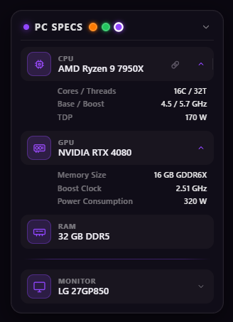

# PC Specs — Widget Editor

[](https://opensource.org/licenses/MIT)
[](#)
[](#)
[](https://fnk3d.github.io/pc-specs/)

A universal info card widget builder — everything in a single HTML file, no server, no dependencies.

Build any list: PC specs, stream setup, favorite games, pets, contacts, a collection — anything you can describe with an icon and a line.

---

## 📸 Preview

> _Replace with your own screenshot_



---

## ✨ Features

- 🎨 **90+ SVG icons** across 12 categories (computer, peripherals, streaming, pets, food, hobbies, stickers, etc.)
- 🧩 **Cards and dividers** — flexible structure for any information
- 📝 **Label + value + expandable details** — from a simple line to a card with parameters
- 🔗 **Links** — a card can open a URL in a new tab
- 🎯 **Drag & drop** — smooth dragging with auto-scroll and a visual drop indicator
- ☑️ **Selection mode** — group move and delete multiple cards at once
- 🎨 **Accent colors** — 3 presets + custom color (hex input), with automatic contrast-aware text color
- 🌍 **Multilingual** — RU + EN with a toggle in the editor header
- 💾 **Auto-save** to the browser's localStorage
- 📤 **Export HTML** — a ready widget as a single file, everything embedded
- 📦 **Export / import JSON** — save and transfer your config
- 🎮 **Easter eggs** — 3 classic cheat codes (Konami, IDDQD, REDPILL)
- 🖱️ **3D tilt** and smooth hover animations
- 📱 **Responsive** — works in the browser and as a standalone HTML file

---

## 🚀 Quick start

1. Download `pc-specs.html`
2. Open the file in your browser (double-click — that's it)
3. Left side — live preview, right side — editor
4. Add cards, customize to your taste
5. Hit **⬇ Export HTML** — you get a ready widget as a single file

No installs, no npm, no build tools, no CDN. Pure HTML + CSS + JS.

---

## 📖 How to use

### Cards and dividers

- **+ Card** — add a card (CPU, GPU, RAM, whatever)
- **+ Divider** — visually split sections (MAIN / PERIPHERALS)

Each card has the following fields:

| Field | What it is |
|---|---|
| **Icon** | 90+ SVGs in a gallery, click the preview → choose |
| **Label** | Small heading above the value (can be left empty) |
| **Value** | The main line (e.g. `AMD Ryzen 9 7950X`) |
| **Link** | Optional. If filled, clicking the card opens it in a new tab |
| **Details** | Expandable list. Each line: `Key \| Value` |

### Moving cards

- Drag the **⠿** handle on the left of a card — smooth drag with auto-scroll
- **↑** / **↓** buttons — move by one position
- **✕** — delete the card

### Selection mode

- Toggle the **"Selection mode"** button above the list
- Click cards — select multiple
- Drag the selection — **group move**
- Double-click — clear selection

### Accent colors

- 3 presets next to the editor title
- **Custom** — clicking the dashed circle opens a palette with a hex input
- Clicking an already-set custom color also opens the palette so you can change it
- **✕** on the custom circle (appears on hover) — removes the custom color

### Export / import

- **⬇ Export HTML** — a ready widget as a single file
- **⬆ JSON** — save config (backup)
- **⬇ JSON** — load config from a file

---

## 🎮 Easter eggs

Three classic cheat codes. Type them on your keyboard — the widget switches to a special mode. Typing the same code again returns to normal.

<details>
<summary><b>Konami Code → AMBER</b></summary>

<kbd>↑</kbd> <kbd>↑</kbd> <kbd>↓</kbd> <kbd>↓</kbd> <kbd>←</kbd> <kbd>→</kbd> <kbd>←</kbd> <kbd>→</kbd> <kbd>B</kbd> <kbd>A</kbd>

Retro CRT monitor: amber text, scanlines, subtle flicker.
</details>

<details>
<summary><b>IDDQD → VAPORWAVE</b></summary>

<kbd>I</kbd> <kbd>D</kbd> <kbd>D</kbd> <kbd>Q</kbd> <kbd>D</kbd>

Neon 80s: pink + cyan, glitch on the title.
</details>

<details>
<summary><b>REDPILL → MATRIX</b></summary>

<kbd>R</kbd> <kbd>E</kbd> <kbd>D</kbd> <kbd>P</kbd> <kbd>I</kbd> <kbd>L</kbd> <kbd>L</kbd>

Digital rain with Japanese katakana, green on black.
</details>

> Codes work when focus is not in an input field.

---

## 🌍 Multilingual

**RU | EN** toggle in the editor header. The language is saved in the browser and embedded into the exported HTML — the widget opens in the language you exported it with.

By default, the language is detected from `navigator.language`: Russian, Ukrainian, Belarusian, Kazakh → RU, everything else → EN.

---

## 🛠️ Technical

- **Single HTML file** — no server, no build, no dependencies
- **Vanilla JS** — no frameworks
- **localStorage** — data is saved automatically
- **Drag & drop** on Pointer Events — works with both mouse and touchscreen
- **Unique IDs** — could be embedded as multiple widgets on the same page (not tested, but architecturally possible)

### File structure

```
.
├── LICENSE              ← MIT
├── README.md            ← this file
└── pc-specs.html        ← editor + widget
```

The exported HTML is fully self-contained: the editor is stripped out, all data is embedded inside. You can send it to a friend — they just open it and see the widget.

---

## 📄 License

**MIT** — use it, modify it, embed it, sell it. The only requirement is to keep the copyright notice and the license text.

Full text: [LICENSE](./LICENSE)

---

## 👤 Author

**FNK3D**

Made with ♥ for streamers, gamers, and anyone who needs to show off a list in style.